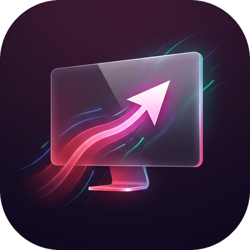

<div align="center">



# 🚀 SIAM RemoteMe Studio (PRO 60FPS)

**โปรแกรมรีโมทคอมพิวเตอร์ความหน่วงต่ำ (Zero-Lag 60FPS) และระบบโอนย้ายไฟล์ความเร็วสูงข้ามแพลตฟอร์ม**  
*รองรับการควบคุมข้ามอินเทอร์เน็ตจากทุกที่ทั่วโลก (4G / 5G / Wi-Fi ต่างเครือข่าย) บน Windows, macOS, Linux, iOS และ Android — ฟรี 100% ตลอดชีพ ไม่จำกัดเวลา*

[](https://github.com/Sirawit45/SIAM-RemoteMe-Studio/releases)
[](#)
[](#)
[](#)

---

### 📥 [ดาวน์โหลดโปรแกรมพกพาคลิกเดียวจบ (`SIAM_RemoteMe_Portable.exe`) ได้ที่หน้า Releases](https://github.com/Sirawit45/SIAM-RemoteMe-Studio/releases/latest)
### 📱 [เปิดเว็บแอปสำหรับมือถือ (Mobile Web App Portal)](https://sirawit45.github.io/SIAM-RemoteMe-Studio/)

</div>

---

## 📖 เกี่ยวกับโปรเจกต์ (Overview)

**SIAM RemoteMe Studio** คือซอฟต์แวร์ Remote Desktop และ File Transfer ส่วนตัวที่ถูกพัฒนาขึ้นเพื่อแก้ปัญหาความหน่วง (Latency) และข้อจำกัดของโปรแกรมรีโมทเชิงพาณิชย์ (ที่ไม่ตัดสายทุก 5 นาที ไม่จำกัดการใช้งาน และไม่ต้องจ่ายรายเดือน) โดยผสานเทคโนโลยี:
- **Raw Binary Frame Streaming (20-Byte Header)**
- **0ms Client-Side Cursor Prediction (ลูกศรเมาส์ขยับตามนิ้วทันทีโดยไม่รอภาพ)**
- **Chunked Resumable File Transfer (ส่งไฟล์ขนาดใหญ่ กดหยุดพักและรันต่อได้)**
- **Global Cloud Edge Tunnel + รหัสเครื่อง 9 หลัก (เชื่อมต่อข้ามเน็ตได้ทั่วโลกโดยไม่ต้องทำ Port Forwarding)**

---

## ✨ คุณสมบัติเด่น (Key Features)

### 1. ⚡ รีโมทหน้าจอลื่นไหลระดับ 60 FPS (Zero-Lag Pipeline)
- **Raw Binary Protocol (20-Byte Header):** ส่งข้อมูลภาพแบบไบนารีโดยตรง ไม่ผ่าน Base64 ลดภาระแบนด์วิดท์ลง 33%
- **0ms Local Cursor Prediction:** แยกเลเยอร์การวาดลูกศรเมาส์ด้วย `requestAnimationFrame` ทำให้ลูกศรบนหน้าจอมือถือ/คอมขยับติดนิ้วทันที (`0.0 ms` local latency)
- **Sub-Millisecond Pixel Diff Check:** ตรวจสอบการเปลี่ยนแปลงของพิกเซลภายใน `< 1 ms` เพื่อไม่ให้ส่งเฟรมภาพซ้ำซ้อนไปอัดแน่นในท่ออินเทอร์เน็ต
- **Stale-Frame Dropper & Zero-Queue Lockstep:** ป้องกันปัญหาภาพค้างสะสมบนมือถือ iPhone/Android ส่งเฉพาะเฟรมล่าสุดแบบเรียลไทม์ (`~3.3 ms` capture time)
- **Hardware GPU 60FPS Mode & Multi-Monitor:** รองรับการดึงภาพจากชิปการ์ดจอโดยตรง และสลับหน้าจอ 1, 2 หรือดูทุกหน้าจอพร้อมกัน

### 2. 📱 ออกแบบมาเพื่อทั้ง คอมพิวเตอร์ และ มือถือ (Mobile PWA & Trackpad)
- **ติดตั้งเป็นแอปบนมือถือได้ (PWA):** รองรับการกด **"เพิ่มไปยังหน้าจอโฮม" (Add to Home Screen)** บน iPhone (Safari) และ Android (Chrome) พร้อมไอคอนโลโก้ 3D เปิดใช้งานแบบเต็มจอเหมือนแอปเนทีฟ
- **โหมดทัชแพด (Trackpad Mode) & โหมดแตะจุด (Direct Touch):** ลากนิ้วบนหน้าจอมือถือเพื่อเลื่อนเมาส์อย่างแม่นยำเหมือนทัชแพดโน้ตบุ๊ก หรือสลับเป็นโหมดแตะตรงจุดได้ในปุ่มเดียว
- **แป้นควบคุมนิ้วโป้ง (Thumb Bar) & ระบบซูมหน้าจอ:** มีปุ่ม `คลิกซ้าย`, `ดับเบิลคลิก`, `คลิกขวา`, `เลื่อนขึ้น/ลง`, `พิมพ์ภาษาไทย/ซิงค์คลิปบอร์ด` และปุ่ม `ซูม 1x / 1.8x / 2.8x`

### 3. 📂 โยกย้ายไฟล์อิสระ + กดหยุดชั่วคราวและรันต่อได้ (Chunked Resumable Transfer)
- **Full Remote File Explorer:** เปิดดูไฟล์ได้ทุกไดรฟ์ (`C:\`, `D:\`, `Desktop`, `Downloads`, `Documents`) สร้างโฟลเดอร์, เปลี่ยนชื่อ, คัดลอก (Copy), ตัดย้าย (Cut/Move), ลบ และพรีวิวรูปภาพ/วิดีโอ/ไฟล์โค้ดได้ทันที
- **Pause & Resume (`1 MiB` Chunk Engine):** หั่นไฟล์รับ-ส่งทีละ `1 MiB` พร้อมหน้าต่างแสดงความเร็ว `MiB/s`, เปอร์เซ็นต์, ปริมาณข้อมูลคงเหลือ และเวลาที่เหลือ (ETA) สามารถกด **หยุดชั่วคราว (Pause)** และ **รันต่อ (Resume)** ได้ทุกเมื่อ
- **Drag & Drop & Auto-Zip:** ลากไฟล์ไปวางบนหน้าจอรีโมทเพื่อส่งไฟล์เข้าเครื่องปลายทาง หรือกดดาวน์โหลดทั้งโฟลเดอร์กลับมาเป็นไฟล์ `.zip` อัตโนมัติ

### 4. 🛡️ ความปลอดภัยสูงสุด & ปุ่มตัดการเชื่อมต่อทันที
- **รหัสเครื่อง 9 หลัก + รหัส PIN 6 หลักเฉพาะเครื่อง:** แต่ละเครื่องจะสุ่มรหัสใหม่ของตัวเองโดยเฉพาะ และบังคับถามรหัส PIN 6 หลักก่อนอนุญาตให้ดูหน้าจอหรือควบคุมเมาส์
- **ปุ่มหยุดการเชื่อมต่อ / เตะผู้ใช้ออกทันที:** มีปุ่มสีแดง `หยุดเชื่อมต่อ` / `หยุดรีโมท` สำหรับฝั่งผู้ควบคุม และปุ่ม `ตัดการเชื่อมต่อทั้งหมด` / `ปิดออนไลน์` สำหรับเจ้าของเครื่องคอมพิวเตอร์

---

## 🔑 ความแตกต่างระหว่าง "รหัสเครื่อง 9 หลัก" กับ "รหัส PIN 6 หลัก"

เพื่อให้ใช้งานได้ง่ายและไม่สับสน ระบบมีรหัส 2 ตัวที่ทำหน้าที่ต่างกัน (เหมือนแอป TeamViewer / AnyDesk) ดังนี้:

| ชื่อรหัส | จำนวนหลัก | ตัวอย่าง | เอาไว้กรอกตอนไหน? |
| :--- | :---: | :---: | :--- |
| **1. รหัสเครื่อง (Device ID)**<br>*(เปรียบเหมือน "เบอร์โทรศัพท์" ของคอม)* | **9 หลัก** | `123 456 789` | กรอกในช่อง **"เชื่อมต่อเครื่องปลายทาง"** ด้านบนสุด ตอนจะค้นหาว่าต้องการเชื่อมต่อไปที่คอมพิวเตอร์เครื่องไหน |
| **2. รหัสผ่านความปลอดภัย (PIN Code)**<br>*(เปรียบเหมือน "รหัสล็อกบ้าน")* | **6 หลัก** | `884210` | กรอกใน **หน้าต่างป๊อปอัปที่เด้งถามรหัส PIN 6 หลัก** เพื่อยืนยันตัวตนก่อนเปิดดูหน้าจอ *(เมื่อกรอกผ่านครั้งแรก มือถือจะจำรหัสไว้ให้อัตโนมัติ)* |

> 💡 **ดูรหัสทั้ง 2 ตัวได้ที่ไหน?**  
> เปิดโปรแกรมบนเครื่องคอมพิวเตอร์ $\rightarrow$ ดูที่หน้าแรก **`แดชบอร์ด & เชื่อมต่อ`** ในกรอบซ้ายมือจะมีทั้ง **รหัสประจำเครื่องนี้ (9 หลัก)** และ **รหัสผ่านความปลอดภัย PIN Code (6 หลัก)** แสดงอยู่ชัดเจน สามารถกดปุ่ม **"สุ่มรหัสใหม่"** หรือตั้งรหัสเองได้ที่เมนู **`ตั้งค่า & ความปลอดภัย`**

---

## 📘 คู่มือการใช้งานฉบับสมบูรณ์ (User Manual)

การใช้งานแบ่งออกเป็น **3 ส่วน** คือ **1) การเปิดโปรแกรมบนคอมพิวเตอร์**, **2) การเปิดใช้งานบนโทรศัพท์มือถือ** และ **3) วิธีหยุดหรือตัดการเชื่อมต่อ**

---

### ส่วนที่ 1: วิธีเปิดโปรแกรมบนคอมพิวเตอร์ (เครื่องที่จะถูกควบคุม)

#### วิธีที่ 1: เปิดจากไอคอนบนหน้าจอ Desktop หรือไฟล์พกพา `.exe` (ง่ายที่สุด)
1. ดับเบิลคลิกที่ไอคอน **SIAM RemoteMe Studio** บนหน้าจอ Desktop หรือไฟล์ **`SIAM_RemoteMe_Portable.exe`** (หรือ **`Start_RemoteMe_App.bat`**)
2. โปรแกรมจะเปิดหน้าต่างแอปขึ้นมาพร้อมสร้างลิงก์ออนไลน์อัตโนมัติ
3. *(ทางเลือก)* หากต้องการให้โปรแกรมทำงานอัตโนมัติทุกครั้งที่เปิดสวิตช์คอมพิวเตอร์ ให้ดับเบิลคลิกไฟล์ **`Portable_Package\ตั้งค่ารันอัตโนมัติตอนเปิดคอม_AutoStart.bat`** เพียงครั้งเดียว

#### วิธีที่ 2: รันจาก Source Code (สำหรับนักพัฒนา หรือ macOS / Linux)
```bash
git clone https://github.com/Sirawit45/SIAM-RemoteMe-Studio.git
cd SIAM-RemoteMe-Studio
pip install -r requirements.txt

# บน Windows:
Start_RemoteMe_App.bat

# บน macOS / Linux:
chmod +x start_remoteme.sh
./start_remoteme.sh
```

---

### ส่วนที่ 2: วิธีเปิดใช้งานและติดตั้งแอปบนโทรศัพท์มือถือ (iPhone / iPad / Android)

คุณสามารถเชื่อมต่อจากมือถือได้ทั้งผ่าน **Wi-Fi ในบ้าน** และ **อินเทอร์เน็ตมือถือ 4G/5G จากนอกบ้าน**:

#### วิธีที่ A: ติดตั้งเป็นไอคอนแอปไว้บนหน้าจอโฮมมือถือ (แนะนำ — ใช้ได้ตลอดแม้รีสตาร์ทคอม)
1. เปิดเบราว์เซอร์บนมือถือ (**Safari** บน iPhone หรือ **Chrome** บน Android) แล้วเข้าลิงก์:
   👉 **[https://sirawit45.github.io/SIAM-RemoteMe-Studio/](https://sirawit45.github.io/SIAM-RemoteMe-Studio/)**
2. **เพิ่มเป็นแอปลงบนหน้าจอมือถือ:**
   - **บน iPhone / iPad (Safari):** กดปุ่ม **แชร์ (Share $\uparrow$)** ด้านล่าง $\rightarrow$ เลือก **"เพิ่มไปยังหน้าจอโฮม" (Add to Home Screen)** $\rightarrow$ กด **เพิ่ม (Add)**
   - **บน Android (Chrome):** กดปุ่มเมนู **จุด 3 จุด ($\vdots$)** มุมขวาบน $\rightarrow$ เลือก **"ติดตั้งแอป" (Install app)** หรือ **"เพิ่มลงในหน้าจอหลัก"**
3. เปิดแอป **SIAM Remote** จากหน้าจอมือถือ $\rightarrow$ พิมพ์ **รหัสเครื่อง 9 หลัก** ของคอมคุณแล้วเลือกวิธีเข้าใช้งานได้ 2 วิธี:
   - **วิธีที่ 1 (ให้เครื่องปลายทางกดยอมรับ):** กดปุ่มสีเขียว **"ส่งคำขอให้เครื่องปลายทางกด 'ยอมรับ'"** $\rightarrow$ บนหน้าจอโปรแกรมที่คอมพิวเตอร์จะมีป๊อปอัปเด้งขึ้นมาให้กด **ยอมรับ (Accept)** หรือ **ปฏิเสธ (Reject)**
   - **วิธีที่ 2 (กรอกรหัส PIN 6 หลัก):** พิมพ์ **รหัส PIN 6 หลัก** แล้วกด **"ยืนยัน PIN"** เพื่อเข้าใช้งานทันที (กรณีไม่มีคนเฝ้าหน้าจอคอม)

#### วิธีที่ B: สแกน QR Code จากหน้าจอคอมพิวเตอร์
1. บนหน้าแรกของโปรแกรมในคอมพิวเตอร์ กดปุ่มสีเขียว **"QR มือถือ"**
2. ใช้กล้องโทรศัพท์มือถือสแกน QR Code เพื่อเปิดแอปมือถือพร้อมรหัสเครื่อง 9 หลักทันที

---

### ส่วนที่ 3: วิธีหยุดการเชื่อมต่อ / ตัดการเชื่อมต่อ (Disconnect)

* **จากฝั่งคนรีโมท (บนมือถือ หรือหน้าจอรีโมท):**
  1. กดปุ่มสีแดง **`หยุดเชื่อมต่อ`** ที่มุมขวาบนสุดของหน้าจอ หรือ
  2. กดปุ่มสีแดง **`หยุดรีโมท`** บนแถบเครื่องมือในหน้า **"รีโมทหน้าจอสด"**
  - **เมื่อกดตัดการเชื่อมต่อแล้ว:** ระบบจะซ่อนข้อมูลทั้งหมด ล้างสิทธิ์การเข้าถึงไฟล์ และบล็อกไม่ให้ดูอะไรได้เลย หากต้องการเชื่อมต่อใหม่อีกครั้งจะต้องส่งคำขอให้เครื่องปลายทางกด **"ยอมรับ"** หรือกรอกรหัส **PIN 6 หลัก** ใหม่ทุกครั้ง
* **จากฝั่งเจ้าของเครื่องคอมพิวเตอร์ (ต้องการเตะคนรีโมทออก หรือปิดออนไลน์):**
  1. **ปุ่ม `ตัดการเชื่อมต่อ`** (ในการ์ดซ้ายบน "อุปกรณ์ที่เชื่อมต่ออยู่"): เตะอุปกรณ์ทุกเครื่องที่กำลังเชื่อมต่ออยู่ให้ออกทันที
  2. **ปุ่มสีแดง `ปิดออนไลน์`**: ปิดอุโมงค์เชื่อมต่อจากภายนอกทันทีเมื่อไม่ต้องการให้ใครรีโมทเข้ามาจากอินเทอร์เน็ต (หากต้องการเปิดใหม่ให้กดปุ่ม `เปิด/รีเฟรชออนไลน์`)
  3. **ปุ่ม `สุ่มใหม่`** (ในกล่อง PIN Code): เปลี่ยนรหัส PIN 6 หลักใหม่พร้อมตัดการเชื่อมต่อเดิมทั้งหมดทันที

---

## ❓ คำถามที่พบบ่อย (FAQ)

### 1. โปรแกรมนี้ใช้ได้ในระยะยาวไหม ต้องเสียเงินรายเดือนหรือไม่?
- **ใช้ได้ในระยะยาวตลอดไป และฟรี 100% ไม่มีค่าใช้จ่ายใดๆ ทั้งสิ้นครับ!**
- ไม่มีการจำกัดเวลา ไม่มีการตัดสายทุก 5 นาที และไม่มีการบล็อกว่าใช้งานเชิงพาณิชย์เหมือนโปรแกรมสำเร็จรูป เพราะโค้ดและเซิร์ฟเวอร์ทำงานอยู่บนเครื่องคอมพิวเตอร์ของคุณเองโดยตรง ส่วนการเชื่อมต่อผ่านอินเทอร์เน็ตใช้โครงข่ายฟรีของ Cloudflare Quick Tunnel และระบบสำรองอัตโนมัติที่ไม่ต้องสมัครสมาชิกและไม่ต้องผูกบัตรเครดิต

### 2. คนอื่นที่เข้ามาดู GitHub นี้จะรีโมทเข้าเครื่องของเราได้ไหม?
- **ไม่ได้อย่างแน่นอนครับ** เพราะระบบไม่แสดงลิงก์ URL หรือ IP บนหน้าจอ และไฟล์ตั้งค่ารหัสเครื่อง/รหัสผ่าน (`remoteme_config.json`) ถูกแยกไว้เฉพาะในเครื่องของคุณเท่านั้น (ไม่ได้ถูกอัปโหลดขึ้น GitHub) เมื่อใครดาวน์โหลดโปรแกรมนี้ไปเปิด โปรแกรมจะสุ่มรหัส 9 หลักและรหัส PIN 6 หลักชุดใหม่ให้เครื่องของคนนั้นเองโดยเฉพาะ

---

## 📂 โครงสร้างไฟล์ในโปรเจกต์ (Project Structure)

```text
SIAM-RemoteMe-Studio/
├── backend/
│   ├── config.py             # จัดการการตั้งค่า, สุ่มรหัสเครื่อง 9 หลัก (Device ID) และรหัส PIN 6 หลัก
│   ├── screen_engine.py      # เอนจินจับภาพหน้าจอความเร็วสูง 60FPS + Pixel Diff + DPI Awareness
│   ├── input_controller.py   # ระบบควบคุมเมาส์และคีย์บอร์ดความหน่วงต่ำ (Win32 SendInput + Pynput)
│   ├── file_manager.py       # ระบบสำรวจไฟล์และ Chunked Resumable Transfer (Pause/Resume/Auto-Zip)
│   ├── system_info.py        # ระบบตรวจสอบสถานะ CPU, RAM, Disk, Network Interfaces และ Clipboard
│   ├── wan_manager.py        # ระบบ Global Cloud Tunnel (Cloudflare Edge/SSH) & 9-Digit ID Directory
│   └── webrtc_signaling.py   # ระบบจัดการเซสชัน, สั่งตัดการเชื่อมต่อ (Disconnect All) และ WebRTC
├── static/
│   ├── index.html            # หน้าต่างโปรแกรมหลัก (Responsive Desktop & Mobile PWA UI)
│   ├── manifest.json         # ไฟล์กำหนดค่า Progressive Web App สำหรับติดตั้งลงหน้าจอมือถือ
│   ├── assets/               # โลโก้แอปพลิเคชัน 3D (PNG, Multi-size ICO, SVG)
│   ├── css/styles.css        # สไตล์ Modern Dashboard, Dark/Light Theme, Animations
│   └── js/
│       ├── app.js            # ระบบควบคุมหลัก, ค้นหารหัส 9 หลัก, QR Code, ตัดการเชื่อมต่อ, ตั้งค่าระบบ
│       ├── remote_viewer.js  # ตัววาดภาพ 60FPS + 0ms Local Cursor Prediction + Mobile Trackpad
│       └── file_transfer.js  # ระบบจัดการไฟล์และคิวโอนย้ายไฟล์แบบ Pause/Resume
├── Portable_Package/         # สคริปต์สำหรับแพ็กเกจพกพาและตั้งค่า Auto-Start ตอนเปิดเครื่อง
├── server.py                 # เซิร์ฟเวอร์หลัก FastAPI + Binary WebSocket + Prevent-Sleep Engine
├── Start_RemoteMe_App.bat    # ตัวเปิดโปรแกรมโหมด Desktop App สำหรับ Windows
├── start_remoteme.sh         # ตัวเปิดโปรแกรมสำหรับ macOS และ Linux
└── requirements.txt          # รายการไลบรารี Python
```

---

## 🛠️ การสร้างไฟล์ `.exe` แบบพกพาด้วยตัวเอง (Build Portable EXE)

หากคุณแก้ไขโค้ดและต้องการคอมไพล์เป็นไฟล์ `SIAM_RemoteMe_Portable.exe` พร้อมไอคอนโลโก้ 3D ใหม่ สามารถรันคำสั่ง:

```bash
pip install pyinstaller pillow
pyinstaller --noconfirm --onefile --name "SIAM_RemoteMe_Portable" \
  --icon "static/assets/logo.ico" \
  --add-data "static;static" \
  --hidden-import "uvicorn.logging" \
  --hidden-import "uvicorn.loops.auto" \
  --hidden-import "uvicorn.protocols.http.auto" \
  --hidden-import "uvicorn.protocols.websockets.auto" \
  --hidden-import "uvicorn.lifespan.on" \
  --hidden-import "pynput.keyboard._win32" \
  --hidden-import "pynput.mouse._win32" \
  server.py
```

---

## 📜 สัญญาอนุญาต (License)

พัฒนาขึ้นเพื่อการใช้งานส่วนตัวและการศึกษาภายใต้สัญญาอนุญาต **MIT License**
