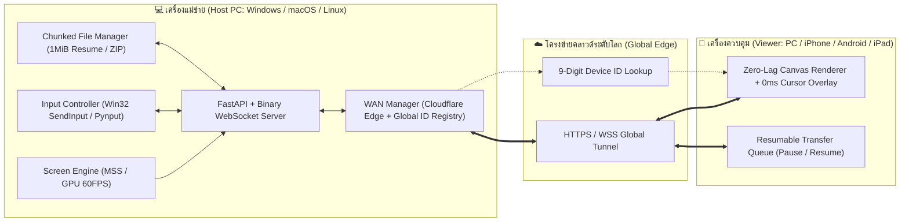

<div align="center">

# 🚀 SIAM RemoteMe Studio (PRO 60FPS)

**โปรแกรมรีโมทคอมพิวเตอร์ความหน่วงต่ำ (Zero-Lag 60FPS) และระบบโอนย้ายไฟล์ความเร็วสูงข้ามแพลตฟอร์ม**  
*รองรับการควบคุมข้ามอินเทอร์เน็ตจากทุกที่ทั่วโลก (4G / 5G / Wi-Fi ต่างเครือข่าย) บน Windows, macOS, Linux, iOS และ Android*

[](https://github.com/Sirawit45/SIAM-RemoteMe-Studio/releases)
[](#)
[](#)
[](#)

---

### 📥 [ดาวน์โหลดโปรแกรมพกพาคลิกเดียวจบ (`SIAM_RemoteMe_Portable.exe`) ได้ที่หน้า Releases](https://github.com/Sirawit45/SIAM-RemoteMe-Studio/releases/latest)

</div>

---

## 📖 เกี่ยวกับโปรเจกต์ (Overview)

**SIAM RemoteMe Studio** คือซอฟต์แวร์ Remote Desktop และ File Transfer ส่วนตัวที่ถูกออกแบบมาเพื่อแก้ปัญหาความหน่วง (Latency) และความยุ่งยากของโปรแกรมรีโมททั่วไป โดยผสานเทคโนโลยี **Raw Binary Frame Streaming**, **0ms Client-Side Cursor Prediction**, **Chunked Resumable File Transfer (กดหยุดชั่วคราวและรันต่อได้)** และ **Global Cloud Edge Tunnel** เข้าด้วยกัน

ผู้ใช้งานสามารถควบคุมคอมพิวเตอร์จากที่ไหนก็ได้ในโลกผ่าน **รหัสประจำเครื่อง 9 หลัก (Device ID)**, **ลิงก์ HTTPS ระดับโลก** หรือ **สแกน QR Code ด้วยมือถือ 4G/5G** โดยไม่ต้องตั้งค่า Port Forwarding บนเราน์เตอร์ และฝั่งผู้ควบคุมไม่ต้องลงแอปพลิเคชันเพิ่มเติม

---

## ✨ คุณสมบัติเด่น (Key Features)

### 1. ⚡ รีโมทหน้าจอลื่นไหลระดับ 60 FPS (Zero-Lag Pipeline)
- **Raw Binary Protocol (20-Byte Header):** ส่งข้อมูลภาพแบบไบนารีโดยตรง ไม่ผ่าน Base64 ลดภาระแบนด์วิดท์ลง 33%
- **0ms Local Cursor Prediction:** แยกเลเยอร์การวาดลูกศรเมาส์ด้วย `requestAnimationFrame` ทำให้ลูกศรบนหน้าจอมือถือ/คอมขยับติดนิ้วทันที (`0.0 ms` local latency)
- **Sub-Millisecond Pixel Diff Check:** ตรวจสอบการเปลี่ยนแปลงของพิกเซลภายใน `< 1 ms` เพื่อไม่ให้ส่งเฟรมภาพซ้ำซ้อนไปอัดแน่นในท่ออินเทอร์เน็ต
- **Stale-Frame Dropper & Zero-Queue Lockstep:** ป้องกันปัญหาภาพค้างสะสมบนมือถือ iPhone/Android ส่งเฉพาะเฟรมล่าสุดแบบเรียลไทม์ (`~3.3 ms` capture time)
- **Hardware GPU 60FPS Mode:** รองรับการดึงภาพจากชิปการ์ดจอโดยตรง และรองรับ **Multi-Monitor** (สลับหน้าจอ 1, 2 หรือดูทุกหน้าจอพร้อมกัน)

### 2. 📱 ออกแบบมาเพื่อทั้ง คอมพิวเตอร์ และ มือถือ (Mobile Trackpad & Responsive UI)
- **Responsive Mobile Layout:** ซ่อนแถบเมนูข้างอัตโนมัติบนมือถือ พร้อม **Bottom Navigation Bar** เหมือนแอปเนทีฟ
- **โหมดทัชแพด (Trackpad Mode) & โหมดแตะจุด (Direct Touch):** ลากนิ้วบนหน้าจอมือถือเพื่อเลื่อนเมาส์อย่างแม่นยำเหมือนทัชแพดโน้ตบุ๊ก หรือสลับเป็นโหมดแตะตรงจุดได้ในปุ่มเดียว
- **แป้นควบคุมนิ้วโป้ง (Thumb Bar) & ระบบซูมหน้าจอ:** มีปุ่ม `คลิกซ้าย`, `ดับเบิลคลิก`, `คลิกขวา`, `เลื่อนขึ้น/ลง`, `พิมพ์ภาษาไทย/ซิงค์คลิปบอร์ด` และปุ่ม `ซูม 1x / 1.8x / 2.8x`

### 3. 📂 โยกย้ายไฟล์อิสระ + กดหยุดชั่วคราวและรันต่อได้ (Chunked Resumable Transfer)
- **Full Remote File Explorer:** เปิดดูไฟล์ได้ทุกไดรฟ์ (`C:\`, `D:\`, `Desktop`, `Downloads`, `Documents`) สร้างโฟลเดอร์, เปลี่ยนชื่อ, คัดลอก (Copy), ตัดย้าย (Cut/Move), ลบ และพรีวิวรูปภาพ/วิดีโอ/ไฟล์โค้ดได้ทันที
- **Pause & Resume (`1 MiB` Chunk Engine):** หั่นไฟล์รับ-ส่งทีละ `1 MiB` พร้อมหน้าต่างแสดงความเร็ว `MiB/s`, เปอร์เซ็นต์, ปริมาณข้อมูลคงเหลือ และเวลาที่เหลือ (ETA) สามารถกด **หยุดชั่วคราว (Pause)** และ **รันต่อ (Resume)** ได้ทุกเมื่อ
- **Drag & Drop & Auto-Zip:** ลากไฟล์ไปวางบนหน้าจอรีโมทเพื่อส่งไฟล์เข้าเครื่องปลายทาง หรือกดดาวน์โหลดทั้งโฟลเดอร์กลับมาเป็นไฟล์ `.zip` อัตโนมัติ

### 4. 🌍 ควบคุมข้ามอินเทอร์เน็ตได้จากทุกที่ทั่วโลก (Global WAN Access)
- **Zero Port-Forwarding:** สร้างอุโมงค์เชื่อมต่อเข้ารหัส HTTPS/WSS ผ่าน Cloudflare Global Edge อัตโนมัติ ทะลุผ่าน CGNAT ของอินเทอร์เน็ตบ้านทุกค่าย (AIS / True / 3BB / NT) และฮอตสปอตมือถือ
- **Global 9-Digit Device ID Directory:** พิมพ์เพียง **รหัสเครื่อง 9 หลัก (เช่น `865 557 579`)** เพื่อค้นหาและเชื่อมต่อเครื่องปลายทางข้ามอินเทอร์เน็ตได้จากทุกที่
- **Unattended 24/7 & Prevent-Sleep Mode:** มีระบบป้องกันเครื่องหลับ (`SetThreadExecutionState`) และสคริปต์ตั้งค่ารันอัตโนมัติตั้งแต่เปิดสวิตช์คอมพิวเตอร์

---

## 🏗️ สถาปัตยกรรมระบบ (System Architecture)



---

## 📘 คู่มือการใช้งานฉบับสมบูรณ์ (User Manual)

การใช้งานแบ่งออกเป็น **2 ฝั่ง** คือ **1) เครื่องที่จะถูกควบคุม (Host)** และ **2) เครื่องที่เราใช้ควบคุม (Client/Viewer)**

---

### ส่วนที่ 1: การเตรียม "เครื่องที่จะถูกควบคุม" (เช่น คอมที่ทำงาน หรือคอมที่บ้าน)

#### วิธีที่ A: ใช้ไฟล์พกพา `.exe` คลิกเดียวจบ (แนะนำสำหรับ Windows - ไม่ต้องลง Python)
1. ดาวน์โหลดไฟล์ **[`SIAM_RemoteMe_Portable.exe`](https://github.com/Sirawit45/SIAM-RemoteMe-Studio/releases/latest)** หรือชุดซิป **`SIAM_RemoteMe_Portable_Package.zip`** จากหน้า Releases
2. ดับเบิลคลิกเปิดไฟล์ **`SIAM_RemoteMe_Portable.exe`**
3. โปรแกรมจะรันเอนจินเบื้องหลัง เปิดโหมดป้องกันเครื่องหลับ (Prevent Sleep) และเปิดหน้าต่างโปรแกรมขึ้นมาพร้อมแสดง:
   - **รหัสประจำเครื่อง 9 หลัก (Device ID)** เช่น `865 557 579`
   - **รหัสผ่านความปลอดภัย (PIN Code)** 6 หลัก
   - **ลิงก์ควบคุมข้ามอินเทอร์เน็ตทั่วโลก (Global Internet URL)** เช่น `https://xxxx.trycloudflare.com`
   - **ปุ่ม QR มือถือ** สำหรับสแกนเข้าควบคุมทันที
4. *(ทางเลือก)* หากต้องการให้คอมเครื่องนี้พร้อมถูกรีโมทตลอด 24 ชม. แม้ไฟดับแล้วเครื่องรีสตาร์ทใหม่ ให้ดับเบิลคลิกไฟล์ **`ตั้งค่ารันอัตโนมัติตอนเปิดคอม_AutoStart.bat`** เพียงครั้งเดียว

#### วิธีที่ B: รันจาก Source Code (สำหรับนักพัฒนา หรือ macOS / Linux)
```bash
# 1. โคลนโปรเจกต์
git clone https://github.com/Sirawit45/SIAM-RemoteMe-Studio.git
cd SIAM-RemoteMe-Studio

# 2. ติดตั้งไลบรารีที่จำเป็น
pip install -r requirements.txt

# 3. รันเซิร์ฟเวอร์และเปิดแอป
# บน Windows:
Start_RemoteMe_App.bat

# บน macOS / Linux:
chmod +x start_remoteme.sh
./start_remoteme.sh
```

---

### ส่วนที่ 2: วิธีเชื่อมต่อจาก "เครื่องที่ใช้ควบคุม" (มือถือ 4G/5G, iPad, โน้ตบุ๊ก)

ฝั่งผู้ควบคุม **ไม่ต้องติดตั้งโปรแกรมใดๆ ทั้งสิ้น** สามารถเลือกเชื่อมต่อได้ 3 ช่องทาง:

1. **สแกน QR Code ด้วยมือถือ (4G / 5G / Wi-Fi):**
   - กดปุ่ม **"QR มือถือ"** บนหน้าแดชบอร์ดของคอมพิวเตอร์ แล้วใช้กล้องมือถือสแกนเพื่อเข้าควบคุมได้ทันที
2. **เปิดผ่านลิงก์ Global URL หรือ LAN URL:**
   - คัดลอกลิงก์ `https://xxxx.trycloudflare.com` (สำหรับคุมข้ามเน็ตจากทุกที่) หรือ `http://192.168.1.x:8765` (สำหรับคุมในบ้าน/ออฟฟิศเดียวกัน) ไปเปิดบนเบราว์เซอร์ Chrome, Safari หรือ Edge
3. **เชื่อมต่อด้วย "รหัสเครื่อง 9 หลัก" (Device ID):**
   - หากเปิดโปรแกรม SIAM RemoteMe Studio บนคอมอีกเครื่อง ให้พิมพ์รหัสเครื่อง 9 หลัก (เช่น `865 557 579`) ในช่องด้านบนสุด แล้วกดปุ่ม **"เชื่อมต่อ"**

---

### ส่วนที่ 3: การใช้งานฟีเจอร์ต่างๆ ในโปรแกรม

| เมนู / ปุ่มควบคุม | วิธีการใช้งาน |
| :--- | :--- |
| **🖥️ รีโมทหน้าจอสด (Remote)** | • เลือกสลับหน้าจอ (`จอที่ 1`, `จอที่ 2`) และโหมดภาพ (`60FPS`, `คมชัด HD`, `ประหยัดเน็ต`)<br>• บนมือถือมีแถบด้านล่างให้สลับ **โหมดทัชแพด** (ลากนิ้วเลื่อนเมาส์ แตะ 1 ครั้งเพื่อคลิก) หรือ **โหมดแตะจุด** พร้อมปุ่ม `คลิกซ้าย`, `ดับเบิลคลิก`, `คลิกขวา`, `เลื่อนขึ้น/ลง` และ `ซูม 1x / 1.8x / 2.8x` |
| **⌨️ พิมพ์ไทย / คลิปบอร์ด** | • กดปุ่ม **"พิมพ์ไทย"** บนแถบเครื่องมือรีโมทเพื่อพิมพ์ข้อความภาษาไทย/อังกฤษส่งเข้าเครื่องปลายทาง หรือดึง/ส่งข้อความใน Clipboard ข้ามเครื่อง |
| **📂 จัดการและโอนย้ายไฟล์** | • เลือกไดรฟ์หรือโฟลเดอร์ด่วน (`Desktop`, `Downloads`, `Documents`, `C:\`)<br>• กดปุ่ม **ส่งไฟล์มาที่นี่** หรือลากไฟล์มาวางเพื่ออัปโหลด<br>• กดปุ่มไอคอน **ดาวน์โหลด** หลังชื่อไฟล์หรือโฟลเดอร์เพื่อดึงไฟล์กลับมาที่เครื่องคุณ |
| **⏯️ รายการโอนย้าย (Pause/Resume)** | • ดูความเร็วการโอนย้าย (`MiB/s`) แบบเรียลไทม์<br>• กดปุ่ม **หยุดพัก (Pause)** เพื่อพักการส่งไฟล์ชั่วคราว และกด **รันต่อ (Resume)** เพื่อส่งต่อจากจุดเดิมโดยไม่ต้องเริ่มใหม่ |
| **🛡️ ตั้งค่า & ความปลอดภัย** | • เปลี่ยนชื่อเครื่อง, ตั้งรหัส PIN 6 หลัก, เปิด/ปิดการบังคับถามรหัส PIN, หรือสลับโหมดดูอย่างเดียว (View-Only) |

---

## 📂 โครงสร้างไฟล์ในโปรเจกต์ (Project Structure)

```text
SIAM-RemoteMe-Studio/
├── backend/
│   ├── config.py             # จัดการการตั้งค่า, รหัสเครื่อง 9 หลัก (Device ID), รหัส PIN
│   ├── screen_engine.py      # เอนจินจับภาพหน้าจอความเร็วสูง 60FPS + Pixel Diff + DPI Awareness
│   ├── input_controller.py   # ระบบควบคุมเมาส์และคีย์บอร์ดความหน่วงต่ำ (Win32 SendInput + Pynput)
│   ├── file_manager.py       # ระบบสำรวจไฟล์และ Chunked Resumable Transfer (Pause/Resume/Auto-Zip)
│   ├── system_info.py        # ระบบตรวจสอบสถานะ CPU, RAM, Disk, Network Interfaces และ Clipboard
│   ├── wan_manager.py        # ระบบ Global Cloud Tunnel (Cloudflare Edge/SSH) & 9-Digit ID Directory
│   └── webrtc_signaling.py   # ระบบจัดการเซสชันและ WebRTC Signaling
├── static/
│   ├── index.html            # หน้าต่างโปรแกรมหลัก (Responsive Desktop & Mobile UI)
│   ├── css/styles.css        # สไตล์ Modern Dashboard, Dark/Light Theme, Animations
│   └── js/
│       ├── app.js            # ระบบควบคุมหลัก, เชื่อมต่อด้วยรหัส 9 หลัก, QR Code, ตั้งค่าระบบ
│       ├── remote_viewer.js  # ตัววาดภาพ 60FPS + 0ms Local Cursor Prediction + Mobile Trackpad
│       └── file_transfer.js  # ระบบจัดการไฟล์และคิวโอนย้ายไฟล์แบบ Pause/Resume
├── Portable_Package/         # สคริปต์สำหรับแพ็กเกจพกพาและตั้งค่า Auto-Start ตอนเปิดเครื่อง
├── server.py                 # เซิร์ฟเวอร์หลัก FastAPI + Binary WebSocket + Prevent-Sleep Engine
├── Start_RemoteMe_App.bat    # ตัวเปิดโปรแกรมโหมด Desktop App สำหรับ Windows
├── start_remoteme.sh         # ตัวเปิดโปรแกรมสำหรับ macOS และ Linux
└── requirements.txt          # รายการไลบรารี Python
```

---

## 🛠️ การสร้างไฟล์ `.exe` แบบพกพาด้วยตัวเอง (Build Portable EXE)

หากคุณแก้ไขโค้ดและต้องการคอมไพล์เป็นไฟล์ `SIAM_RemoteMe_Portable.exe` ใหม่ สามารถรันคำสั่ง:

```bash
pip install pyinstaller
pyinstaller --noconfirm --onefile --name "SIAM_RemoteMe_Portable" \
  --add-data "static;static" \
  --hidden-import "uvicorn.logging" \
  --hidden-import "uvicorn.loops.auto" \
  --hidden-import "uvicorn.protocols.http.auto" \
  --hidden-import "uvicorn.protocols.websockets.auto" \
  --hidden-import "uvicorn.lifespan.on" \
  --hidden-import "pynput.keyboard._win32" \
  --hidden-import "pynput.mouse._win32" \
  server.py
```

---

## 📜 สัญญาอนุญาต (License)

พัฒนาขึ้นเพื่อการใช้งานส่วนตัวและการศึกษาภายใต้สัญญาอนุญาต **MIT License**
